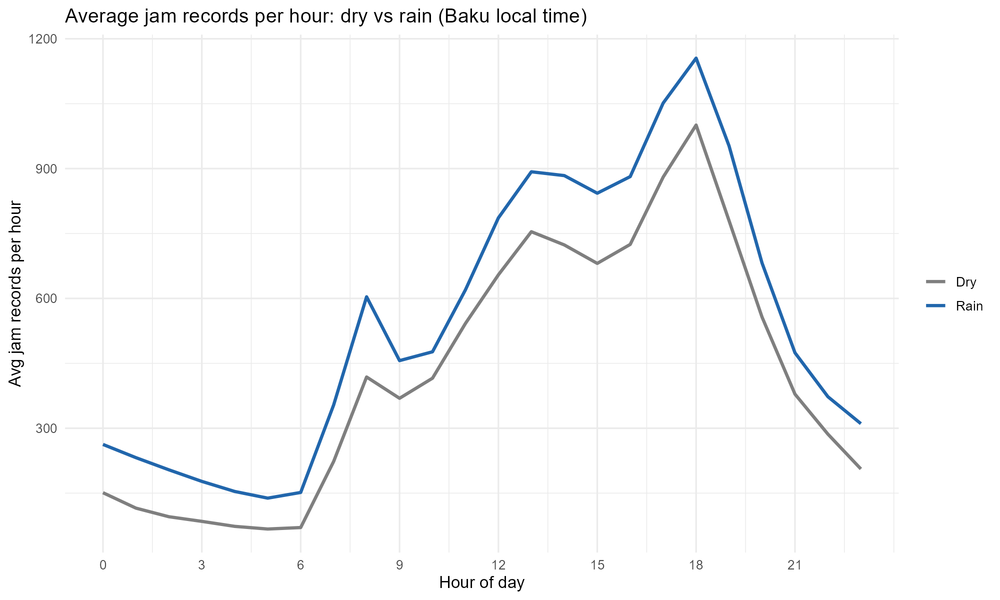
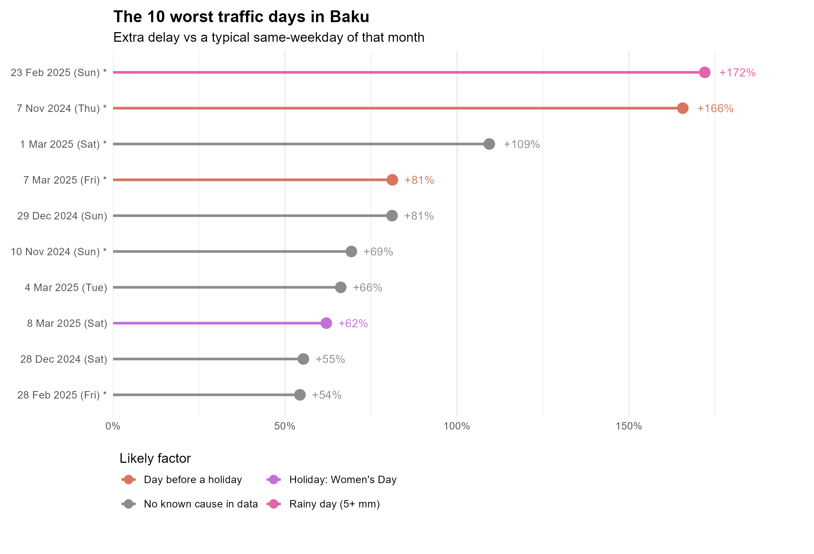
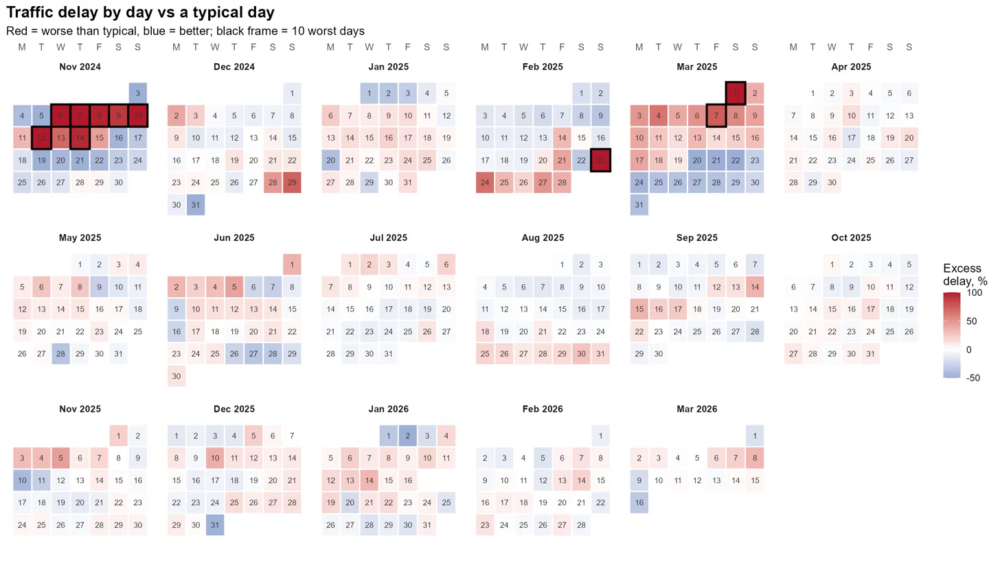

```{r}
#| include: false
Sys.setlocale("LC_TIME", "C")   # English month and weekday names
library(tidyverse); library(lubridate); library(plotly); library(leaflet)
library(DT); library(scales); library(sf); library(crosstalk)

fmt    <- function(x, d = 0) format(round(x, d), big.mark = ",", nsmall = d, trim = TRUE)
wd_lab <- c("Mon", "Tue", "Wed", "Thu", "Fri", "Sat", "Sun")

txt  <- "#e6edf3"
grid <- "rgba(255,255,255,0.12)"

# Dark styling for interactive charts (hover boxes are dark with white text)
dk <- function(p) {
  p %>% layout(paper_bgcolor = "rgba(0,0,0,0)", plot_bgcolor = "rgba(0,0,0,0)",
               font = list(color = txt),
               xaxis = list(gridcolor = grid, zerolinecolor = grid),
               yaxis = list(gridcolor = grid, zerolinecolor = grid),
               hoverlabel = list(bgcolor = "#16212e", bordercolor = "#f2b705",
                                 font = list(color = "#ffffff")))
}
# Dark styling for static charts
theme_static <- function(base = 12) {
  theme_minimal(base_size = base) +
    theme(plot.background  = element_rect(fill = "#111c28", colour = "#2b3a4d"),
          panel.background = element_rect(fill = NA, colour = NA),
          text = element_text(colour = txt), axis.text = element_text(colour = "#aab4c0"),
          panel.grid.major = element_line(colour = "#ffffff1f"),
          panel.grid.minor = element_blank(),
          strip.text = element_text(colour = txt, face = "bold"),
          legend.text = element_text(colour = txt),
          legend.title = element_text(colour = txt, face = "bold"),
          plot.title = element_text(face = "bold", size = base + 4, colour = "#ffffff"),
          plot.subtitle = element_text(colour = "#9fb0c3"),
          plot.margin = margin(14, 18, 12, 14))
}

# Find the data folder even if the working directory is different
data_dir <- c("data", "../data", "../../data")
data_dir <- data_dir[file.exists(file.path(data_dir, "kpi.rds"))][1]
if (is.na(data_dir)) stop("Cannot find data/kpi.rds. The working directory is: ", getwd())
rd <- function(f) readRDS(file.path(data_dir, f))

kpi          <- rd("kpi.rds")
profile      <- rd("profile.rds")
wd_tbl       <- rd("wd_tbl.rds")
monthly      <- rd("monthly.rds")
streets      <- rd("streets.rds")
hex          <- rd("hex_map.rds")
hex_hour     <- rd("hex_hour.rds")
results      <- rd("results.rds")
rain_profile <- rd("rain_profile.rds")
daily        <- rd("daily.rds")
worst        <- rd("worst.rds")
reasons      <- rd("reasons.rds")
excl         <- rd("excluded_days.rds")
lines_rush   <- rd("lines_rush.rds")

pk     <- profile %>% filter(type == "Weekday") %>% slice_max(km, n = 1, with_ties = FALSE)
period <- paste(format(kpi$date_from, "%d %b %Y"), "to", format(kpi$date_to, "%d %b %Y"))
```

## Key numbers

::::::: kpis
::: kpi
**`r fmt(kpi$n_raw / 1e6, 2)` million** Waze jam records in the dataset
:::

::: kpi
**`r kpi$n_days` days** analysed, `r period`
:::

::: kpi
**`r fmt(kpi$km_avg)` km** of road in a jam at any one moment, on average
:::

::: kpi
**`r sprintf("%+.0f", kpi$rain_pct)`%** estimated extra reported delay in rainfall hours
:::
:::::::

::: notebox
**How the numbers work.** Waze data was saved as a snapshot every 5 minutes. Each snapshot lists the jams Waze saw at that moment, and every jam has a length. **Kilometres of road in a jam** is the total length of all jams in a snapshot, averaged over the hour, day or month shown. **Reported delay** is the delay in minutes that Waze gives for each jam, added up. It is a comparison index, not the exact time drivers lost. All times are Baku time and all charts use the analysed days, `r period`.
:::

## Summary

- Jams are heaviest on weekdays at **`r sprintf("%02d:00", pk$hr)`**, with about `r fmt(pk$km)` km of road in a jam at the same time.
- The street with the most reported delay is **`r streets$street[1]`**, with about `r fmt(streets$delay_h[1])` hours of reported delay over the whole period.
- Among the 500 m cells, `r sum(hex$pattern == "All-day")` are slow all day, `r sum(hex$pattern == "Morning-heavy")` mainly in the morning and `r sum(hex$pattern == "Evening-heavy")` mainly in the evening.
- In hours with 1 mm of rain or more, reported delay is **`r sprintf("%+.1f", kpi$rain_pct)`%** compared with dry hours at the same time of day.
- The largest single-day excess was **`r format(worst$date[1], "%d %B %Y")`**, with about `r fmt(worst$excess_pct[1])`% more reported delay than a typical day of the same weekday and month.

## Overview

### By month

Average reported delay per day in each month (bars) and the average delay of one jam (line). Days with abnormal data collection are excluded.

```{r}
monthly_d <- daily %>%
  mutate(year_month = format(date, "%Y-%m")) %>%
  group_by(year_month) %>%
  summarise(delay_per_day = mean(delay_hours), .groups = "drop") %>%
  left_join(monthly %>% select(year_month, avg_delay), by = "year_month")

plot_ly(monthly_d, x = ~year_month) %>%
  add_bars(y = ~delay_per_day, name = "Delay hours per day", marker = list(color = "#f2b705"),
           text = ~sprintf("%.1f", delay_per_day), textposition = "inside", insidetextanchor = "end",
           textfont = list(color = "#0f1923", size = 11),
           hovertemplate = "%{x}<br>%{y:.1f} delay hours per day<extra></extra>") %>%
  add_lines(y = ~avg_delay, name = "Delay per jam (min)", yaxis = "y2",
            line = list(color = "#ff5a5f", width = 3),
            hovertemplate = "%{x}<br>%{y:.1f} min delay per jam<extra></extra>") %>%
  layout(xaxis = list(title = ""),
         yaxis = list(title = "Delay hours per day", rangemode = "tozero", tickformat = ".0f"),
         yaxis2 = list(overlaying = "y", side = "right", title = "Delay per jam, min",
                       tickformat = ".1f", nticks = 6, rangemode = "tozero",
                       range = c(0, max(monthly_d$avg_delay, na.rm = TRUE) * 1.3),
                       gridcolor = "rgba(0,0,0,0)"),
         legend = list(orientation = "h", y = -0.2)) %>%
  dk()
```

### A typical day

Average length of road in a jam at each hour of the day, on weekdays (Mon–Fri) and weekends (Sat–Sun). The shaded bands are the usual rush hours.

```{r}
plot_ly(profile, x = ~hr, y = ~km, color = ~type,
        colors = c(Weekday = "#f2b705", Weekend = "#4da3ff"),
        type = "scatter", mode = "lines+markers", line = list(width = 3), marker = list(size = 6),
        hovertemplate = "%{x}:00<br>%{y:.1f} km of road in a jam<extra></extra>") %>%
  layout(
    xaxis = list(title = "Hour of day (Baku time)", dtick = 2, range = c(-0.5, 23.5)),
    yaxis = list(title = "Kilometres of road in a jam", rangemode = "tozero"),
    legend = list(orientation = "h", y = -0.25),
    shapes = list(
      list(type = "rect", xref = "x", yref = "paper", x0 = 7.5,  x1 = 10.5, y0 = 0, y1 = 1,
           fillcolor = "rgba(242,183,5,0.10)", line = list(width = 0)),
      list(type = "rect", xref = "x", yref = "paper", x0 = 16.5, x1 = 20.5, y0 = 0, y1 = 1,
           fillcolor = "rgba(242,183,5,0.10)", line = list(width = 0))),
    annotations = list(list(x = pk$hr, y = pk$km, text = sprintf("Weekday peak at %02d:00", pk$hr),
                            showarrow = TRUE, arrowcolor = "#f2b705", ax = -70, ay = -35,
                            font = list(color = "#ffffff")))) %>%
  dk()
```

### Which weekday is worst

Average length of road in a jam over the whole day, for each day of the week.

```{r}
wd_p <- wd_tbl %>% mutate(day = factor(wd_lab[wd], levels = wd_lab))
plot_ly(wd_p, x = ~day, y = ~km, type = "bar",
        marker = list(color = ifelse(wd_p$wd >= 6, "#4da3ff", "#f2b705")),
        hovertemplate = "%{x}<br>%{y:.1f} km of road in a jam<extra></extra>") %>%
  layout(xaxis = list(title = ""), yaxis = list(title = "Kilometres of road in a jam", rangemode = "tozero")) %>%
  dk()
```

## Hotspots

The city is cut into 500 m hexagons. The colour is the **reported delay** summed over the whole period (`r period`) and ranked among the cells: the redder, the more delay. Use the switch to change the time of day (all days of the week) and click a cell for details.

```{r}
layers <- c("All day" = "delay_h", "Morning peak (07–10)" = "morning_h",
            "Evening peak (17–20)" = "evening_h")
m <- leaflet(height = 560) %>%
  addProviderTiles("Esri.WorldGrayCanvas") %>%
  setView(49.85, 40.39, 11)

for (nm in names(layers)) {
  col <- layers[[nm]]
  d   <- hex[hex[[col]] > 0, ]
  v   <- d[[col]]
  pal <- colorQuantile("YlOrRd", v, n = 7)
  m <- m %>% addPolygons(
    data = d, group = nm, fillColor = pal(v), fillOpacity = 0.65, color = "white", weight = 0.4,
    highlightOptions = highlightOptions(weight = 2, color = "#333", bringToFront = TRUE),
    popup = paste0("<b>", d$street, "</b><br>Reported delay in this layer: ", fmt(v), " hours<br>",
                   "Reported delay, all day: ", fmt(d$delay_h), " hours<br>",
                   "Average speed: ", round(d$avg_speed, 1), " km/h<br>Pattern: ", d$pattern))
}
m %>%
  addLegend(pal = colorQuantile("YlOrRd", hex$delay_h, n = 7), values = hex$delay_h,
            title = "Delay percentile", position = "bottomright") %>%
  addLayersControl(baseGroups = names(layers), options = layersControlOptions(collapsed = FALSE))
```

## The city through a weekday

Press **Play** or drag the slider to see where jams appear hour by hour on an average weekday (Mon–Fri). A dot is a 500 m area where a jam is reported in that hour. **The colour shows how slow traffic is there: the redder the dot, the slower the traffic, and the paler the dot, the faster it moves.** Hover over a dot to see the street and the speed.

```{r}
#| error: true
hh <- hex_hour %>%
  mutate(hour_lab = sprintf("%02d:00", hr),
         tip = paste0("<b>", street, "</b><br>Average speed in jams: ", round(speed), " km/h")) %>%
  arrange(hr)

plot_ly(hh, type = "scattermapbox", mode = "markers", lat = ~lat, lon = ~lon, frame = ~hour_lab,
        text = ~tip, hoverinfo = "text", height = 700,
        marker = list(size = 13, color = ~speed, cmin = 0, cmax = 30, opacity = 0.9,
                      colorscale = list(c(0, "#8b0000"), c(0.3, "#e31a1c"),
                                        c(0.65, "#fd8d3c"), c(1, "#fee391")),
                      colorbar = list(title = list(text = "km/h", font = list(color = txt)),
                                      tickfont = list(color = txt), len = 0.7, thickness = 14))) %>%
  layout(mapbox = list(style = "open-street-map", zoom = 10.6, center = list(lon = 49.85, lat = 40.39)),
         margin = list(l = 0, r = 0, t = 0, b = 110), paper_bgcolor = "rgba(0,0,0,0)",
         plot_bgcolor = "rgba(0,0,0,0)", font = list(color = txt)) %>%
  animation_opts(frame = 800, transition = 300, redraw = TRUE) %>%
  animation_slider(currentvalue = list(prefix = "Time: ", font = list(color = "#ffffff")))
```

## Jams in rush hour

A random sample of 3,000 jam lines on weekdays at 08:00–09:59 and 17:00–19:59 with speed under 25 km/h. Tick the speed classes you want to see.

```{r}
cols <- c("Under 5 km/h" = "#ff3b3b", "5–12 km/h" = "#ff9f1c", "12–25 km/h" = "#ffe14d")
m2 <- leaflet(height = 560) %>%
  addProviderTiles("Esri.WorldGrayCanvas") %>%
  setView(49.85, 40.39, 12)

for (k in names(cols)) {
  d <- lines_rush[lines_rush$speed_class == k, ]
  m2 <- m2 %>% addPolylines(
    data = d, group = k, color = cols[[k]], weight = 4, opacity = 0.85,
    popup = paste0("<b>", d$street, "</b><br>Speed: ", round(d$speedKMH, 1),
                   " km/h<br>Delay: ", round(d$delay_min, 1), " min"))
}
m2 %>%
  addLegend(position = "bottomright", colors = unname(cols), labels = names(cols), title = "Traffic speed") %>%
  addLayersControl(overlayGroups = names(cols), options = layersControlOptions(collapsed = FALSE))
```

## Streets

One row per street. Reported delay in hours is summed over all jam records in the whole period (`r period`).

```{r}
streets %>% slice_max(delay_h, n = 15) %>%
  plot_ly(x = ~delay_h, y = ~reorder(street, delay_h), type = "bar", orientation = "h",
          marker = list(color = "#f2b705"),
          hovertemplate = "%{y}<br>%{x:,.0f} hours of reported delay<extra></extra>") %>%
  layout(title = "Streets with the most reported delay",
         xaxis = list(title = "Reported delay, hours"), yaxis = list(title = "")) %>%
  dk()
```

The table lists the 200 streets with the most reported delay. **Hours per day with a jam** shows for how many hours a day, on average, at least one jam is reported on that street. A street with an average speed close to zero is most likely closed or blocked, not ordinary congestion. Use the boxes under the titles to search or filter.

```{r}
streets %>%
  transmute(Street = street,
            `Hours per day with a jam` = round(jam_hours_day, 1),
            `Delay per jam, min` = round(delay_per_jam, 1),
            `Average speed, km/h` = round(avg_speed, 1),
            `Reported delay, hours` = round(delay_h)) %>%
  datatable(rownames = FALSE, filter = "top", options = list(pageLength = 10))
```

## Rain

Every hour is matched with Open-Meteo precipitation. Light rain is 0.1 to 1 mm per hour and rainfall is 1 mm per hour or more (`r fmt(kpi$rain_hours)` hours). Period: `r period`.

### Dry vs rain, by hour of day

{fig-alt="Line chart of average jam records per hour for dry and rainy hours"}

This is a plain comparison of averages. Rain and time of day are mixed in it, so the chart below removes that effect.

### How much worse is it in the rain?

Rainy hours compared with dry hours at the same hour of day, weekday and month. A bar above zero means more than in dry hours. The thin line is the 95% interval: if it crosses zero, the difference is not clear.

```{r}
res <- results %>%
  mutate(level = as.character(level), level = ifelse(level == "Moderate+ rain", "Rainfall", level)) %>%
  filter(!str_detect(outcome, "speed")) %>%
  mutate(measure = ifelse(str_detect(outcome, "elay"), "Reported delay", "Road length in a jam"),
         group = ifelse(level == "Rainfall", "Rainfall (1+ mm/h)", "Light rain (0.1–1 mm/h)"),
         group = factor(group, levels = c("Light rain (0.1–1 mm/h)", "Rainfall (1+ mm/h)")))

plot_ly(res, x = ~measure, y = ~estimate, color = ~group,
        colors = c("Light rain (0.1–1 mm/h)" = "#7fb8ff", "Rainfall (1+ mm/h)" = "#f2b705"),
        type = "bar", text = ~sprintf("%+.0f%%", estimate), textposition = "inside",
        insidetextfont = list(color = "#0f1923", size = 15),
        error_y = ~list(type = "data", symmetric = FALSE, array = hi - estimate,
                        arrayminus = estimate - lo, color = "#e6edf3"),
        hovertemplate = ~paste0(group, "<br>", measure, ": ", sprintf("%+.1f", estimate),
                                "% (95% interval ", sprintf("%+.1f", lo), " to ", sprintf("%+.1f", hi),
                                ")<extra></extra>")) %>%
  layout(barmode = "group", xaxis = list(title = ""),
         yaxis = list(title = "Extra compared with dry hours, %", ticksuffix = "%"),
         legend = list(orientation = "h", y = -0.2)) %>%
  dk()
```

## Worst days

Each day is compared with a typical day of the same weekday and month, then checked against holidays, events and rain. The measure is reported delay for the whole day. Period: `r period`. `r if (!kpi$qc_applied) "Days marked * had abnormal data collection (see Method), so treat them with caution." else ""`

{fig-alt="Chart of the ten worst traffic days with the likely factor for each"}

### Calendar

Every day compared with a typical day of the same weekday and month. Red is worse than typical and blue is better. A black frame marks the 10 worst days.

{fig-alt="Calendar of every day compared with a typical day"}

### What goes with busy days?

Each bar is the average difference from a typical day (same weekday and month) for the days with that likely factor. The number of days is in brackets. A bar to the right means busier than a typical day.

```{r}
fac <- daily %>%
  mutate(group = case_when(str_detect(reason, "^Holiday") ~ "Public holiday",
                           reason %in% c("COP29", "Formula 1 Baku GP") ~ "Big event (COP29, Formula 1)",
                           TRUE ~ reason)) %>%
  group_by(group) %>%
  summarise(days = n(), avg = mean(excess_pct), .groups = "drop") %>%
  mutate(label = paste0(group, " (", days, " days)"),
         label = fct_reorder(label, avg))

plot_ly(fac, x = ~avg, y = ~label, type = "bar", orientation = "h",
        marker = list(color = ifelse(fac$avg >= 0, "#f2b705", "#4da3ff")),
        text = ~sprintf("%+.0f%%", avg), textposition = "outside",
        hovertemplate = ~paste0(group, "<br>", days, " days<br>Average ",
                                sprintf("%+.1f", avg), "% vs a typical day<extra></extra>")) %>%
  layout(xaxis = list(title = "Average difference from a typical day, %", ticksuffix = "%"),
         yaxis = list(title = "")) %>%
  dk()
```

Days are assigned to one factor in this order: event, public holiday, day before a holiday, heavy rain hour, rainy day. “No known cause in data” means none of these applies.

## Method and limitations

**Data.** Waze jam records for Baku (Kaggle, “Baku traffic jams 2024–2026”) and hourly precipitation from the Open-Meteo archive. Timestamps in the dataset are already in Baku local time: the daily rush-hour pattern (a jump around 08:00 and a peak around 18:00) only makes sense on that reading. Analysis in R with tidyverse, dplyr, sf, leaflet, plotly and Quarto.

**How measures are built.** Waze data was saved every 5 minutes. In every snapshot the lengths of all jams are added up, and these totals are averaged over the hour, day or month. Because it is an average per snapshot, gaps in data collection do not change the comparisons.

**Limitations.**

- Waze only sees drivers who use the app, so counts are not all traffic.
- Reported delay adds up the delay Waze gives for each jam record. It is a comparison index, not the exact time lost by all drivers, because the data has no traffic volumes. A jam that lasts long appears in many snapshots.
- Jam lengths are added up as reported. If two jam lines overlap on the same road, that stretch is counted twice, so kilometres can be slightly overstated.
- Each jam is placed at the start of its line, so a long jam counts in one cell.
- Rain comes from one point in central Baku.
- A holiday or event on a bad day is a likely factor, not proof of cause.
- Records without a street name or with a non-positive duration were removed (`r fmt(kpi$n_records)` of `r fmt(kpi$n_raw)` records remain).
- The rush-hour map shows a random sample of 3,000 lines, not every jam.
